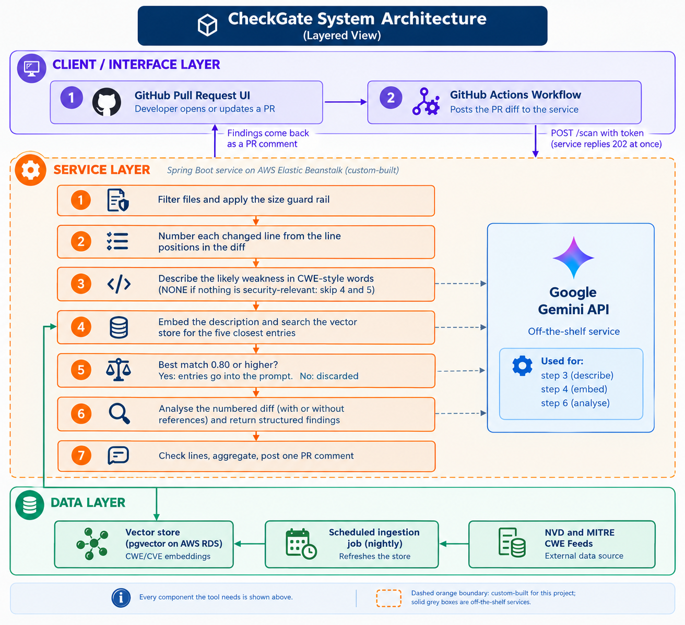

# CheckGate

**Explainable, retrieval-grounded vulnerability detection for pull requests, using large language models.**

CheckGate reviews the code changes in a GitHub pull request for security weaknesses. It numbers every changed line, describes the likely weakness, looks up current CWE and CVE entries, asks a Gemini model to analyse the change, and posts one comment that names each weakness, explains it, and points to the line.

This repository contains the service, its GitHub Actions workflows, an evaluation runner, and the scripts used to evaluate CheckGate against CodeQL.

## Status

- **v0.1.0:** the working prototype, deployed on AWS Elastic Beanstalk and scanning pull requests through GitHub Actions.
- **Evaluation complete:** 400 labelled Java functions from the Java part of MegaVul, three prompt conditions, three runs each, with CodeQL as the baseline and an independent language-model judge for explanation quality. Aggregate results are in `evaluation/results-summary/`.

Headline results: on the 395 functions CodeQL could be matched to, CheckGate with references found 26.1% of vulnerable functions against 9.6% for CodeQL, and raised false alarms on 12.2% of safe functions against 2.5%. Retrieved references raised recall and false alarms together without improving precision. The judge scored CheckGate's explanations about 1.9 points higher on clarity and 1.2 points higher on trustworthiness than CodeQL's messages (5-point scale).

## How a scan works



1. A GitHub Actions workflow runs when a pull request is opened or updated and posts the diff to the service (`POST /scan`, protected by a shared token). The service answers at once and scans in the background.
2. The service filters files and applies a size guard rail.
3. Each changed line is numbered from the diff's hunk headers.
4. The model describes the likely weakness in CWE-style words, or answers NONE.
5. The description is embedded and matched against the five closest CWE and CVE entries in a pgvector store.
6. Entries reach the model only if the best match scores 0.80 or higher.
7. The model analyses the numbered diff, the reported lines are checked against the lines actually shown, and one comment is posted.

Nightly jobs refresh the reference entries from the NVD (CVE) and MITRE (CWE).

## Repository layout

| Path | What it holds |
|---|---|
| `checkgate-service/` | The Spring Boot service (Java 25) |
| `checkgate-service/src/test/` | Unit tests (no network, database or API key needed) |
| `.github/workflows/` | `checkgate.yml` (scan each pull request) and `deploy.yml` (deploy `main` to Elastic Beanstalk) |
| `evaluation/` | Sampling, CodeQL, analysis and judge scripts, and a summary of the results. See `evaluation/README.md` |
| `docs/` | Diagrams |

## Configuration

The service reads these environment variables (or properties in an `application-local.yaml`, which is git-ignored):

| Variable | Purpose |
|---|---|
| `DB_HOST`, `DB_PORT`, `DB_USERNAME`, `DB_PASSWORD` | PostgreSQL with the pgvector extension |
| `GEMINI_API_KEY` | Gemini API key |
| `GEMINI_MODEL`, `GEMINI_RETRIEVAL_THINKING`, `GEMINI_ANALYSIS_THINKING` | Optional. Defaults: `gemini-3.5-flash-lite`, `MEDIUM`, `LOW` |
| `GITHUB_TOKEN` | Token that can comment on pull requests |
| `CHECKGATE_API_TOKEN` | Shared token that protects `/scan` |
| `NVD_API_KEY` | Optional. Raises the NVD rate limit |

The similarity floor (`checkgate.rag.min-similarity`, default 0.80) and the number of entries retrieved (`checkgate.rag.top-n`, default 5) are properties in `application.yaml`.

## Build, test and run

```
cd checkgate-service
mvn -DskipTests package
java -jar target/checkgate-service-0.0.1-SNAPSHOT.jar
```

To run the unit tests only:

```
mvn test -Dtest=LineAnnotationServiceTest,LineCrossValidationServiceTest,EvaluationRunnerTest,ScanPipelineServiceTest,GeminiRetryTest
```

To add CheckGate to a repository, copy `.github/workflows/checkgate.yml` and set the secrets `CHECKGATE_URL` (the service address) and `CHECKGATE_TOKEN` (the value of `CHECKGATE_API_TOKEN`).

## Known limitations

- Traffic from GitHub Actions to the service is plain HTTP, and secrets are kept as plain-text environment properties.
- Source code is sent to a third-party model. Use paid terms for any private code.
- Java only; function-level evaluation on small and medium open-source projects.

## Author

Oshan Mendis. Supervisor: Dr. Haider Ali.

## Licence

MIT. See the LICENSE file.
