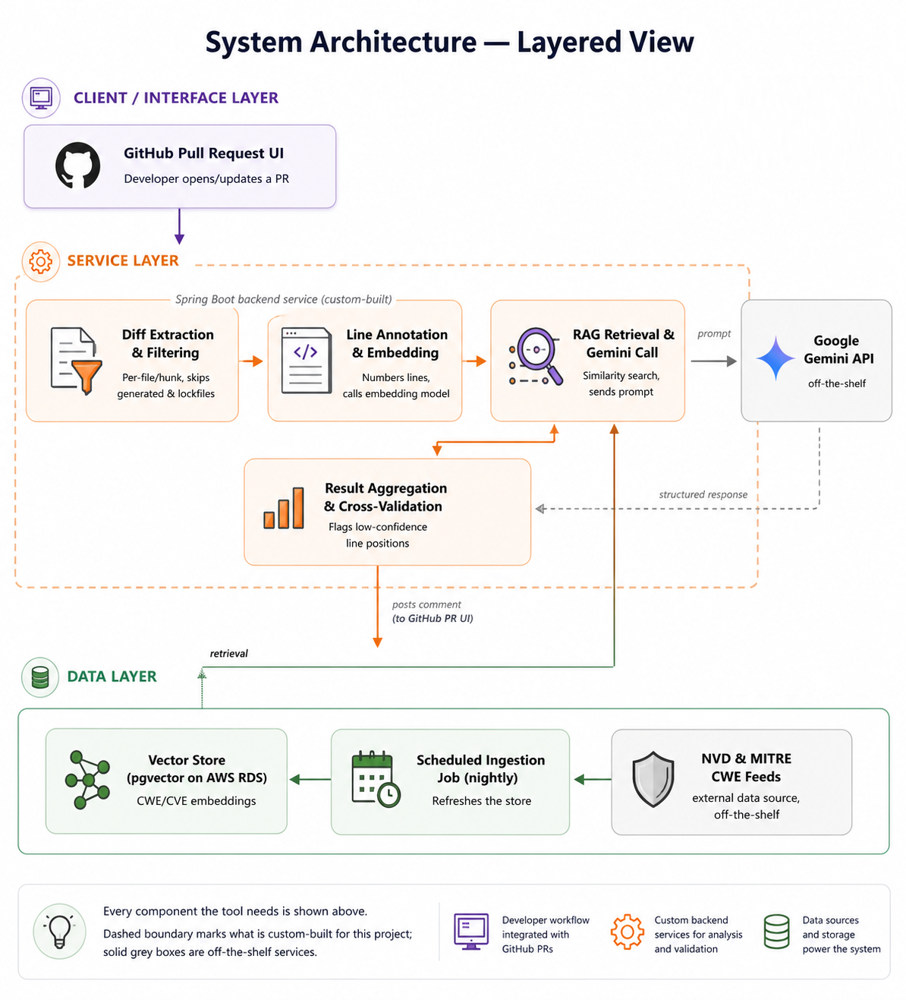

# CheckGate

**Explainable, retrieval-grounded vulnerability detection for CI/CD pipelines, using large language models.**

CheckGate is a GitHub Actions–integrated service that scans pull requests against Java Spring Boot codebases for security vulnerabilities. It uses the Google Gemini API, grounded in current CWE/CVE reference data through retrieval-augmented generation (RAG), to produce explained findings.

## Why CheckGate

Traditional static analysis tools (SAST) are precise in *how* they operate but produce a high rate of false positives. Recent benchmarks show LLMs beating SAST tools on raw detection accuracy, but that accuracy comes with problems: explanation quality is rarely studied, reported performance is often overstated by weak benchmarks, model reasoning breaks under trivial code changes, and no existing research evaluates one of these tools actually deployed inside a live CI/CD pipeline.

CheckGate is built to close that specific, three-part gap: **explainability**, **reliability**, and **pipeline integration**.

## Architecture

## Tech Stack

| Layer | Technology |
|---|---|
| Backend service | Java, Spring Boot |
| Cloud hosting | AWS |
| CI/CD | GitHub Actions |
| LLM (generation) | Google Gemini API |
| LLM (embeddings) | `gemini-embedding-001` |
| Vector database | pgvector on AWS RDS (Postgres) |
| Reference data sources | NVD (CVE), MITRE (CWE) |
| SAST baseline | CodeQL |
| Evaluation benchmark | [MegaVul](https://github.com/Icyrockton/MegaVul) (Java subset) |

## Scope

CheckGate is a **CWE-classification tool**: it identifies categories of coding weakness in Java source code (e.g. SQL injection, access control issues, XSS). It is designed for incremental, pull-request-triggered scanning of a code diff, not full-repository baseline scans. A guard rail skips automated scanning and recommends manual review for changes above a size threshold. Full-repository scanning is considered as future work.

## Author

**Oshan Mendis**

## License

License to be determined before first release.
